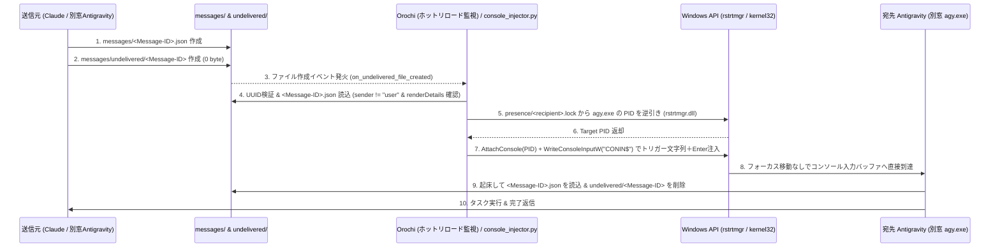

# Antigravity × Claude / 別窓エージェント連携 ワークフロー & 単体テスト仕様書 (`WORK_FLOW.md`)

- **対象スクリプト**: [`console_injector.py`](./console_injector.py)
- **連携フレームワーク**: `orochi`（ホットリロード / ファイル監視エンジン）
- **対象環境**: Windows 10/11 + Python >=3.10 (`uv run python`)

---

## 1. 全体ワークフロー仕様 (WORK FLOW)

### 1.1 背景と解決する課題
Antigravity CLI (`agy.exe`) は、別プロセス（別窓）や外部エージェント（Claude Code 等）からメッセージファイルが配置されても、アイドル状態（キー入力待ち）の間は `messages\undelivered\` フォルダをポーリング監視しない。
本ツール (`console_injector.py`) は、ウィンドウのフォーカスを一切奪わずに OS カーネルのコンソール入力バッファ (`CONIN$`) へ直接キーイベントを注入し、別窓の Antigravity をバックグラウンドで自動起床（Wakeup）させる。

### 1.2 ディレクトリ構造とファイルライフサイクル

```text
C:\Users\User\.gemini\antigravity-cli\
├── presence\
│   └── <会話ID>.lock                    # 起動中の agy.exe プロセスが排他ロックを保持
└── brain\
    └── <会話ID>\
        └── .system_generated\
            └── messages\
                ├── <Message-ID>.json    # ① メッセージ本体（本文・sender・recipient 等）
                ├── read.json            # ③ 既読管理ファイル（受信完了時に "<Message-ID>": true が追記）
                └── undelivered\
                    └── <Message-ID>     # ② 未読マーカー（0バイト・拡張子なし / 受信完了時に自動削除）
```

### 1.3 シーケンス（Claude / 別窓 ➔ Antigravity 自動連携フロー）



---

## 2. コンポーネント（関数）仕様一覧

| # | 関数・定数名 | 引数 | 戻り値 | 責務 |
| :--- | :--- | :--- | :--- | :--- |
| 1 | `UUID_REGEX` | - | `re.Pattern` | `^[0-9a-f]{8}-[0-9a-f]{4}-[0-9a-f]{4}-[0-9a-f]{4}-[0-9a-f]{12}$` による厳密な16進小文字UUID検証 |
| 2 | `create_external_message` | `recipient_id`, `content`, `sender_id="claude-agent"`, `message_title`, `base_brain_dir` | `Path` (`undelivered/<Message-ID>`) | Claude 等の外部エージェントから Antigravity 互換の `<Message-ID>.json` と `undelivered/<Message-ID>` を生成する |
| 3 | `validate_and_load_message` | `undelivered_file_path` | `Optional[Dict[str, Any]]` | `undelivered/<Message-ID>` のUUID形式検証、親階層の `<Message-ID>.json` 読込、および人間入力 (`sender == "user"`) の除外フィルタリング |
| 4 | `find_agy_pid_by_conversation_id` | `conversation_id` | `Optional[int]` | Windows Restart Manager API (`rstrtmgr.dll`) で `presence/<会話ID>.lock` を保持している `agy.exe` の `PID` を特定する |
| 5 | `inject_console_input` | `target_pid`, `text`, `send_enter=True`, `submit_delay_sec=0.08` | `bool` | `AttachConsole` + `WriteConsoleInputW` により、ウィンドウフォーカスを奪わずに `target_pid` の `CONIN$` へキー入力を注入する |
| 6 | `on_undelivered_file_created` | `undelivered_file_path`, `wake_prompt` | `bool` | `orochi` のファイル検知イベントから直接呼ぶ統合ハンドラ（検証 ➔ PID逆引き ➔ コンソール注入を一括実行） |

---

## 3. 単体テスト仕様書 (Unit Test Specification)

### 3.1 テスト実行環境・前提条件
- **作業ディレクトリ**: `C:\Users\User\myapp\my_prompt`
- **Python 実行コマンド**: `C:\Users\User\myapp\my_prompt\.venv\Scripts\python.exe`（または `uv run python`）
- **実機疎通テスト用の起動中会話ID例**:
  - 窓1（依頼・検証側）: `11111111-1111-1111-1111-111111111111`
  - 窓2（テストターゲット側）: `22222222-2222-2222-2222-222222222222`

---

### 3.2 テストケース一覧

#### 【カテゴリ1】UUID正規表現バリデーション (`UUID_REGEX`)

| テストID | テスト観点 | 入力値 | 期待される結果 | 区分 |
| :--- | :--- | :--- | :--- | :--- |
| **UT-01-01** | 正常なUUIDv4形式（小文字16進数 8-4-4-4-12） | `"22222222-2222-2222-2222-222222222222"` | マッチ成功 (`Match` オブジェクトが返る) | 正常系 |
| **UT-01-02** | 大文字アルファベットを含むUUID | `"FC2C30B9-E024-4B5D-A30D-8EAC848567B2"` | マッチ失敗 (`None`) | 異常系 |
| **UT-01-03** | 16進数外の文字 (`g`〜`z`) を含む文字列 | `"gc2c30b9-e024-4b5d-a30d-8eac848567b2"` | マッチ失敗 (`None`) | 異常系 |
| **UT-01-04** | `read.json` などの非UUIDファイル名 | `"read"` / `"read.json"` / `""` | マッチ失敗 (`None`) | 境界値 |

---

#### 【カテゴリ2】外部メッセージ生成 (`create_external_message`)

| テストID | テスト観点 | 入力値 | 期待される結果 | 区分 |
| :--- | :--- | :--- | :--- | :--- |
| **UT-02-01** | Claudeからの新規メッセージファイルペア生成 | `recipient_id="22222222-2222-2222-2222-222222222222"`, `content="Claudeからのテスト"`, `sender_id="claude-code"`, `base_brain_dir=tmp_path` | 1. 戻り値の `undelivered/<Message-ID>` が存在しサイズが `0` バイトであること<br>2. 親階層に `messages/<Message-ID>.json` が存在すること<br>3. JSON内に `"id"`, `"recipient"`, `"sender": "claude-code"`, `"priority": "MESSAGE_PRIORITY_HIGH"`, `"renderDetails"`, `"content"` が正しく格納されていること | 正常系 |
| **UT-02-02** | 複数回呼び出し時の Message-ID 一意性 | 同一引数で2回連続呼び出し | 1回目と2回目で異なる `<Message-ID>` (UUID) のファイルが生成されること | 正常系 |
| **UT-02-03** | 不正な宛先会話IDの拒否 | `recipient_id="invalid-id"` | `ValueError` が送出されること | 異常系 |

---

#### 【カテゴリ3】メッセージ検証・読み込み (`validate_and_load_message`)

| テストID | テスト観点 | 入力値・事前状態 | 期待される結果 | 区分 |
| :--- | :--- | :--- | :--- | :--- |
| **UT-03-01** | 外部エージェント（別窓 / Claude）からの正常メッセージ | `sender="claude-code"`（または別窓UUID）かつ `"renderDetails"` を持つ `<Message-ID>.json` と `undelivered/<Message-ID>` | JSONの辞書オブジェクト (`dict`) が返り、`data["content"]` 等が取得できること | 正常系 |
| **UT-03-02** | 人間（ユーザー）入力メッセージの除外（無限ループ防止） | `"sender": "user"` の `<Message-ID>.json` | `None` が返ること（発火対象外として除外されること） | 異常系 |
| **UT-03-03** | `renderDetails` キーが存在しないJSONの除外 | `"sender": "other"` だが `"renderDetails"` キーがないJSON | `None` が返ること | 異常系 |
| **UT-03-04** | ファイル名がUUID形式でない場合（例: `read.json`） | `undelivered/read.json` または `messages/read.json` | `None` が返ること | 異常系 |
| **UT-03-05** | 対応する親階層の `<Message-ID>.json` が存在しない場合 | `undelivered/<UUID>` のみ存在し、親の `<UUID>.json` がない状態 | 例外でクラッシュせず `None` が返ること | 異常系 |

---

#### 【カテゴリ4】会話IDからのPID逆引き (`find_agy_pid_by_conversation_id`)

| テストID | テスト観点 | 入力値 | 期待される結果 | 区分 |
| :--- | :--- | :--- | :--- | :--- |
| **UT-04-01** | 起動中の会話IDからのPID特定 | 現在開いている会話ID（例: `22222222-2222-2222-2222-222222222222` または `11111111-1111-1111-1111-111111111111`） | 正の整数 (`int > 0`) の `PID` が返り、そのPIDが実在する `agy.exe` プロセスであること | 正常系 |
| **UT-04-02** | 存在しない（または閉じた）会話IDの指定 | `"00000000-0000-0000-0000-000000000000"` | `None` が返ること | 異常系 |
| **UT-04-03** | 不正フォーマットの会話ID指定 | `"not-a-uuid"` | `ValueError` が送出されること | 異常系 |

---

#### 【カテゴリ5】コンソール入力バックグラウンド注入 (`inject_console_input`)

| テストID | テスト観点 | 入力値 | 期待される結果 | 区分 |
| :--- | :--- | :--- | :--- | :--- |
| **UT-05-01** | 起動中別窓プロセスへの非フォーカス入力注入 | `target_pid=<別窓PID>`, `text="テスト"`, `send_enter=True` | 1. 戻り値が `True` であること<br>2. 実行元のコンソール（標準出力 `print`）が実行後も正常に機能していること（親コンソールへの再アタッチ成功）<br>3. ウィンドウフォーカスが奪われずに対象プロセスの入力バッファへ到達すること | 正常系 |
| **UT-05-02** | 存在しないPIDを指定した場合の安全なフォールバック | `target_pid=99999999` | 1. 例外でクラッシュせず `False` が返ること<br>2. 実行元プロセスの親コンソールが維持され、以降の `print()` が正常に出力されること | 異常系 |

---

#### 【カテゴリ6】統合ハンドラ & Claude ↔ Antigravity テスト通信 (`on_undelivered_file_created`)

| テストID | テスト観点 | テスト手順 | 期待される結果（合格基準） | 区分 |
| :--- | :--- | :--- | :--- | :--- |
| **UT-06-01** | Claude から別窓 Antigravity (`fc2c30b9-...`) へのメッセージ送信＆自動起床 | Claude（またはCLI）から `create_external_message` ➔ `on_undelivered_file_created` を実行 | 1. 戻り値が `True` であること<br>2. 別窓 (`22222222-2222-2222-2222-222222222222`) がフォーカスを奪わずに自動起床すること<br>3. 数秒以内に `undelivered/<Message-ID>` が削除され、`read.json` に `<Message-ID>: true` が記録されること<br>4. 別窓の `transcript.jsonl` に `<SYSTEM_MESSAGE>` として Claude のメッセージが記録され、応答または指定アクションが実行されること | E2E正常系 |
| **UT-06-02** | ユーザーメッセージ検知時のスキップ動作 | `"sender": "user"` のファイルを `on_undelivered_file_created` に渡す | 戻り値が `False` となり、コンソール注入が実行されないこと | E2E異常系 |

---

## 4. Claude / テスト実行者向け コマンドリファレンス

### 4.1 Claude から別窓 Antigravity (`22222222-2222-2222-2222-222222222222`) へ直接テスト通信を送るワンライナー

`C:\Users\User\myapp\my_prompt` ディレクトリにて以下を実行すると、メッセージファイルの生成から別窓のバックグラウンド起床までが一発で実行されます：

```powershell
uv run python Antigravity/tools/console_injector.py `
  --conversation 22222222-2222-2222-2222-222222222222 `
  --sender claude-code `
  --send-message "こんにちは！Claude Codeからの通信テストです。受信できたら確認メッセージを出力してください。"
```

### 4.2 既存の `undelivered/<Message-ID>` ファイルを指定して起床させる場合（Orochi 連携相当）

```powershell
uv run python Antigravity/tools/console_injector.py `
  --undelivered-file "C:\Users\User\.gemini\antigravity-cli\brain\22222222-2222-2222-2222-222222222222\.system_generated\messages\undelivered\<Message-ID>"
```
