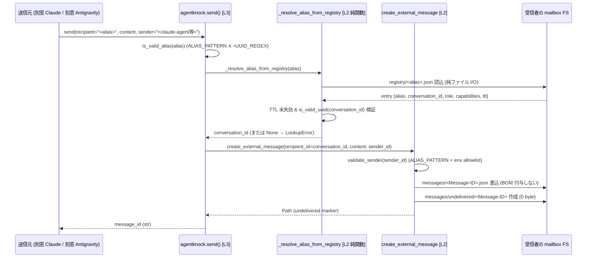
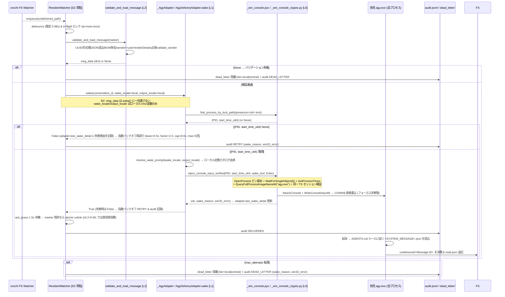

# agentknock v0.2 / v0.3.1 ワークフロー & 単体テスト仕様書 (`WORK_FLOW.md`)

- **対象パッケージ**: [`agentknock`](../agentknock/) (公開 L3) + [`console_injector.py`](../console_injector.py) (L2/L3 実装) + [`_watcher.py`](../_watcher.py) (受信側常駐 D2) + [`_registry.py`](../_registry.py) (純 L2 D3) + [`agentknock/_adapter.py`](../agentknock/_adapter.py) (非公開 L1) + [`agentknock/adapters/agy.py`](../agentknock/adapters/agy.py) (v0.3/v0.3.1 公開 L1 アダプタ) + [`_win_console.pyx`](../_win_console.pyx) (nogil L0) + [`agentknock/adapters/_win_console_ctypes.py`](../agentknock/adapters/_win_console_ctypes.py) (純 Python `ctypes` L0 フォールバック)
- **連携フレームワーク**: `orochi`（ファイル監視エンジン）— `_watcher.ResidentWatcher.enqueue` に接続する
- **対象環境**: Windows 10/11 + Python ≥ 3.10 (`uv run python`)
- **D0 契約**: [`_contract.py`](../_contract.py) が型と不変条件を凍結保持する
- **関連 ADR**: `Antigravity/tools/orochi/DESIGN-0001-agentknock-positioning.md`

---

## 1. 全体ワークフロー仕様 (WORK FLOW)

### 1.1 背景と v0.2 アーキテクチャ転換

Antigravity CLI (`agy.exe`) は、別プロセスからメッセージファイルが配置されても、アイドル状態の間は `messages/undelivered/` フォルダをポーリング監視しない。これを打破するために、本ツールは Win32 カーネル API (`AttachConsole` + `WriteConsoleInputW`) で対象 `agy.exe` の `CONIN$` にキーイベントを注入し、フォーカスを奪わずにバックグラウンドで自動起床 (Wakeup) させる。

しかし v0.1 では「送信者が直接 `CONIN$` を叩く」ため、送信者は実質的に受信者オーナーのキー入力なりすまし権限を得ていた。v0.2 (DESIGN-0001) ではこれを**二段分離**に転換した:

- **送信側 (L3 `send`)** — mailbox (`<Message-ID>.json` + `undelivered/<Message-ID>`) に署名付き JSON を投函するのみ。`CONIN$`・PID・Win32 層へは**静的コールグラフ上**到達しない (R2)。
- **受信側 (D2 `ResidentWatcher`)** — 受信者自身のローカル常駐ウォッチャが `undelivered/` 生成イベントを検知し、JSON 検証後に**ローカル定数カタログ由来の起床ナッジ**だけを `CONIN$` に書き込んで自分自身を叩き起こす (`wake, not command`)。

この結果、`CONIN$` に乗る文字列は常に受信側ローカル定数となり、`source: USER_EXPLICIT` としてタグ付けされてもなりすまし問題が発生しない (R2)。送信者が指定した本文は常に `<SYSTEM_MESSAGE>` 署名付きチャネルからのみ届く (帰属可能)。

### 1.2 ディレクトリ構造とファイルライフサイクル

```text
C:\Users\User\.gemini\antigravity-cli\
├── registry\                                   # ★v0.2 新規: opt-in 自己広告台帳 (R1)
│   └── <alias>.json                            #   {alias, conversation_id, role, capabilities, ttl (ISO-8601 UTC)}
├── presence\
│   └── <会話ID>.lock                            # 起動中の agy.exe が排他ロックを保持 (Restart Manager API で PID 逆引き)
├── dead_letter\                                # ★v0.2 新規: 中央 dead-letter 層 (tier=central)
│   └── <Message-ID>.json                       #   会話ID特定不能時 (JSON破損/recipient欠落/recipient が UUID形式でない等) の fallback
├── audit.jsonl                                 # ★v0.2 新規: 追記専用監査ログ (DELIVERED / RETRY / DEAD_LETTER)
└── brain\
    └── <会話ID>\
        └── .system_generated\
            └── messages\
                ├── <Message-ID>.json           # ① 本文 (sender, recipient, renderDetails, content)
                ├── read.json                   # ③ 既読管理 (agy.exe が <Message-ID>: true を追記)
                ├── undelivered\
                │   └── <Message-ID>            # ② 0バイト未読マーカー (ウォッチャが ack_grace 後に atomic 消費)
                └── dead_letter\                # ★v0.2 新規: ローカル dead-letter 層 (tier=local)
                    └── <Message-ID>.json       #   recipient の会話ID が特定済みの場合の第一選択
```

### 1.3 シーケンス（v0.2 二段分離フロー）

v0.1 では一枚図だったが、v0.2 では**送信側シーケンス**と**受信側シーケンス**を分離表記する。両者は mailbox ファイル (`<Message-ID>.json` + `undelivered/<Message-ID>`) のみを共有し、プロセス間の同期チャネルを持たない。

#### 1.3.a 送信側: `agentknock.send()` (L3 → 純 L2 まで)



**R2 構造保証**: このシーケンス全体は `_adapter`/`_win_console`/`_win_console_ctypes`/`CONIN$`/`AttachConsole`/`OpenProcess`/`GetProcessTimes`/`find_process_by_lock_path`/`inject_console_input_verified`/`_find_process_identity` に静的コールグラフ上到達しない (`tests/test_d4_r2_r1_invariants.py::test_r2_send_callgraph_no_win_console_conin` および `tests/test_v031_toctou_security.py::test_r2_forbidden_symbols_include_v031_toctou_symbols` が `DEFAULT_FORBIDDEN_SYMBOLS` を用いた AST 解析で fail-closed に強制)。送信側は mailbox 書込のみで即時完了し、受信者プロセスへは一切接触しない。

#### 1.3.b 受信側: `ResidentWatcher.on_undelivered` (D2 → L1 → L0)



**R2 構造保証**: 受信側は `ResidentWatcher` / `WatchDaemon` → `_AgyAdapter.wake` / `AgyDeliveryAdapter.wake` → `_win_console.inject_console_input_verified`（Cython `.pyd` または `agentknock/adapters/_win_console_ctypes.py`）の経路で `CONIN$` に触れるが、注入する `text` は `resolve_wake_prompt()` で解決されるローカル定数カタログ (`WAKE_NUDGE_CATALOG` / `WAKE_BODY_CATALOG` / `OUTPUT_DIRECTIVE_CATALOG`) 由来のみ。`msg_data` から導出・連結・補間しない (`tests/test_t3_security.py::test_r2_wake_prompt_never_derives_from_msg_data` が強制)。また、失敗時は `adapter.last_wake_detail` に `reason` / `win32_error` が保持され、`WatchDaemon` が `audit.jsonl` の `RETRY` / `DEAD_LETTER` イベントへ `wake_reason` と `win32_error` を記録する（本文や起床ナッジ等の秘匿情報は記録しない）。

**R1 保証**: 送信側 `send()` は `registry/<alias>.json` に opt-in 登録された受信者にしか到達できない。`list_recipients()` は (TTL 未失効 ∧ `presence/<conversation_id>.lock` 生存) で絞り込み、`conversation_id` を返さない (`tests/test_d4_r2_r1_invariants.py::test_r1_list_recipients_filters_unregistered`)。

---

## 2. コンポーネント（関数・クラス）仕様一覧

### 2.1 L3 — 公開 API 面 (`agentknock.__init__`, `console_injector.py`)

`agentknock/__init__.py` は `send` と `list_recipients` のみを再公開する。`dir(agentknock) == ["send", "list_recipients"]` が強制される (`test_r2_public_namespace_only_send_list_recipients`)。

| # | 関数名 | 引数 | 戻り値 | 責務 | 層 | R2 到達性 |
| :--- | :--- | :--- | :--- | :--- | :--- | :--- |
| 1 | `agentknock.send` / `console_injector.send` | `recipient: str` (alias, 生 UUID 不可), `content: str`, `*, sender: str`, `base_brain_dir`, `registry_dir` | `str` (message_id) | alias 宛て mailbox 投函。`is_valid_alias` → `_resolve_alias_from_registry` → `create_external_message` で mailbox にペアを生成。CONIN$ には到達不能 | L3 | **不到達** |
| 2 | `agentknock.list_recipients` / `_registry.list_recipients` | `*, registry_dir`, `presence_dir`, `now`, `is_lock_alive` | `list[Recipient]` (`{alias, role, capabilities}` のみ) | opt-in 台帳から (TTL 未失効 ∧ presence ロック生存) のみ返却。`conversation_id` は漏洩しない | L3 (純 L2 実装) | **不到達** |

### 2.2 L2 — 純ファイル I/O (`_registry.py`, `console_injector.py`)

| # | 関数名 | 引数 | 戻り値 | 責務 | 層 |
| :--- | :--- | :--- | :--- | :--- | :--- |
| 3 | `_registry.is_valid_alias` | `alias: object` | `bool` | `ALIAS_PATTERN` (`^[a-zA-Z0-9_-]{1,64}$`) に一致**かつ** `UUID_REGEX` に一致しないこと。生 conversation_id を alias として受け付けない (D0 Amendment #1) | L2 |
| 4 | `_registry.is_valid_uuid` | `value: object` | `bool` | `UUID_REGEX` (`^[0-9a-f]{8}-...-[0-9a-f]{12}$`) 厳密小文字 16 進検証 | L2 |
| 5 | `_registry._resolve_alias_from_registry` | `alias: str`, `*, registry_dir`, `now` | `Optional[str]` (conversation_id) | `registry/<alias>.json` を純ファイル読込。TTL 失効 / alias 不整合 / UUID 不正なら `None`。**Win32 非依存** — `send()` のコールグラフ分離の要 | L2 (純) |
| 6 | `_registry.register_self` | `alias, conversation_id, role, *, capabilities, ttl_seconds` or `ttl_iso`, `registry_dir`, `presence_dir`, `require_live_lock` | `Path` | opt-in 自己広告。atomic (`os.replace` via `.<alias>.<uuid>.tmp`)。`__all__` 非公開。既定 `require_live_lock=True` | L2 |
| 7 | `_registry.unregister_self` | `alias, *, conversation_id, registry_dir` | `bool` | opt-in 自己広告の取り下げ。`conversation_id` 指定時は所有権検証 (他セッションの alias を消せない)。`__all__` 非公開 | L2 |
| 8 | `console_injector.UUID_REGEX` (compiled) / `_contract.UUID_REGEX` (str) | - | `re.Pattern` / `str` | 契約の正本は `_contract.py`。他モジュールはそれを import | const |
| 9 | `console_injector.create_external_message` | `recipient_id`, `content`, `sender_id`, `message_title`, `base_brain_dir` | `Path` | `<Message-ID>.json` + `undelivered/<Message-ID>` ペア生成。sender は `validate_sender` を通過しないと `ValueError`。`messageTitle` は `_attributed_title` で帰属明示＋サニタイズ (T3) | L2 |
| 10 | `console_injector.validate_and_load_message` | `undelivered_file_path` | `Optional[Dict]` | ファイル名 UUID 検証 → `<Message-ID>.json` 読込 (BOM 自動除去 & 再保存) → `sender != "user"` → `renderDetails` 必須 → `validate_sender`。NG 時 `None` | L2 |
| 11 | `console_injector.validate_sender` | `sender_id`, `allowed_senders=_ENV_DEFAULT` | `bool` | `ALIAS_PATTERN` フォーマット検査 (常時) + env `CONINJECT_ALLOWED_SENDERS` が設定されている**とき**のみ所属検査 (T3) | L2 |
| 12 | `console_injector._sanitize_title` / `_attributed_title` | `title` | `str` | 制御文字除去＋長さクリップ (120 文字) → `"[sender-supplied] <title>"` 形式で帰属明示 (T3) | L2 |

### 2.3 L2 — i18n 起床ナッジ解決 (R2 境界)

これらはすべて `msg_data` を引数に取らない純関数。CONIN$ に書く文字列は必ずローカル定数カタログ由来となる。

| # | 関数・定数名 | 引数 | 戻り値 | 責務 |
| :--- | :--- | :--- | :--- | :--- |
| 13 | `WAKE_NUDGE_CATALOG` / `WAKE_BODY_CATALOG` / `OUTPUT_DIRECTIVE_CATALOG` | - | `MappingProxyType` | ローカル凍結定数カタログ (`en, ja, zh, ko, es, fr, de`)。各ロケールのナッジ本文はその言語で記述＋明示的 "Respond in <lang>." ディレクティブを併記 (language mirroring + 決定論的言語固定) |
| 14 | `resolve_locale` | `locale`, `*, env_var` | `str` | env → 引数 → `'en'`。不正/未対応は fail-closed で `'en'` |
| 15 | `resolve_wake_locale` | `wake_locale` | `str` | 優先順位: env `CONINJECT_WAKE_LOCALE` → env `CONINJECT_LOCALE` → 引数 → `'en'` |
| 16 | `resolve_output_locale` | `output_locale`, `*, fallback_locale` | `str` | 優先順位: env `CONINJECT_OUTPUT_LOCALE` → env `CONINJECT_LOCALE` → 引数 → fallback → `'en'` |
| 17 | `resolve_wake_prompt` | `wake_locale`, `output_locale` | `str` | 解決済み (wake, output) ロケールから `WAKE_BODY_CATALOG[wake] + " " + OUTPUT_DIRECTIVE_CATALOG[output]` を構築。戻り値は**必ず**カタログ由来。これが R2 境界の最終防衛線 |

### 2.4 D2 — 受信側常駐ウォッチャ (`_watcher.py`)

`_contract._Watcher` プロトコル準拠。**`_AgyAdapter.wake()` の唯一の本番呼び出し元**。

| # | クラス/メソッド | 引数 | 戻り値 | 責務 |
| :--- | :--- | :--- | :--- | :--- |
| 18 | `ResidentWatcher.__init__` | `adapter: _AgyAdapter`, `validator`, `*, agy_base_dir`, `brain_dir`, `audit_log_path`, `wake_locale`, `output_locale`, `debounce_sec=0.08`, `ack_grace_sec=1.5`, `base_backoff_sec=0.5`, `backoff_factor=2.0`, `max_backoff_sec=8.0`, `max_attempts=5`, `clock`, `sleep_fn` | - | 常駐ウォッチャ構築。clock/sleep は差し込み可能 (テスト seam) |
| 19 | `ResidentWatcher.on_undelivered` | `undelivered_path: str\|Path` | `bool` | 同期エントリ: debounce → in-flight ロック (`_in_flight` set) & dispatched 済み重複排除 (`_dispatched_ids` set) → `validator(marker)` → 失敗時 dead_letter 隔離 → 成功時 `_adapter.wake(cid, wake_locale, output_locale)` → ack_grace 待機 & marker 消費 → `audit.jsonl` 追記 → 失敗時 `_compute_backoff` で指数リトライ → 最大試行枯渇で dead_letter |
| 20 | `ResidentWatcher.enqueue` | `undelivered_path` | `None` | 非同期エントリ (orochi FS スレッドから呼ぶ)。`_ScheduledTask` を heapq に積むだけ。stall ゼロ |
| 21 | `ResidentWatcher.start` / `stop` | `timeout=2.0` | `None` | `_worker_loop` 用デーモンスレッド起動/停止 |
| 22 | `ResidentWatcher._worker_loop` | - | - | 背景ディスパッチ。lock 外で `on_undelivered` 実行 (nogil 注入が enqueue を阻害しない) |
| 23 | `ResidentWatcher._quarantine_to_dead_letter` | `marker, *, message_id, recipient_id, sender_id, attempts, reason` | `Path` | **2 段 dead_letter**: 会話ID (recipient_id) が UUID 形式で特定できた場合 → `tier=local` (`brain/<cid>/.system_generated/messages/dead_letter/`)、会話ID が特定不能な場合 (JSON 破損で validator が None を返した / recipient 欠落 / recipient が UUID 形式でない / marker パスが有効な brain 配下にない) → `tier=central` (`AGY_BASE_DIR/dead_letter/`) への fallback。`os.replace` で atomic 移動 + diagnostic stub |
| 24 | `ResidentWatcher._compute_backoff` | `attempt` | `float` | `base_backoff_sec * backoff_factor^(attempt-1)` を `max_backoff_sec` で頭打ち |
| 25 | `ResidentWatcher._wait_or_consume_marker` | `marker_path` | `None` | ack_grace 間 `agy.exe` の dequeue を待機。残存なら atomic `unlink` (再起動越し at-most-once 保証) |
| 26 | `ResidentWatcher._append_audit` | `*, event, message_id, sender, recipient, attempts, reason, tier?, dead_letter_path?` | `None` | `audit.jsonl` に JSON 一行追記 (append-only) |

### 2.5 L1 — 非公開アダプタ (`agentknock/_adapter.py`) & 公開アダプタ (`agentknock/adapters/agy.py`)

`_adapter.py` は **`__all__` 非公開**。受信側常駐ウォッチャ (`ResidentWatcher` / `WatchDaemon`) と診断 CLI (`doctor` / `--undelivered-file`) のみが遅延 import する。v0.3.1 ではネイティブ Cython 拡張 `_win_console` が未ビルドの環境でも `agentknock.adapters._win_console_ctypes` に自動フォールバックし (`pyximport` とルート `_win_console.py` スタブは廃止)、`last_wake_detail` の記録 (`WatchDaemon` 経由で `audit.jsonl` の `wake_reason` / `win32_error` へ反映) を行う。

| # | クラス/メソッド | 引数 | 戻り値 | 責務 | 層 |
| :--- | :--- | :--- | :--- | :--- | :--- |
| 27 | `_AgyAdapter.__init__` / `AgyDeliveryAdapter.__init__` | `*, base_dir, brain_dir, presence_dir, registry_dir, ...` (`AgyDeliveryAdapter` は `allowed_images=("agy.exe",)` 等の検証設定も保持) | - | テスト用ディレクトリ差し替え seam と `last_wake_detail` 初期化 | L1 |
| 28 | `_AgyAdapter._find_process_identity` / `_find_pid` | `conversation_id: str` | `Optional[tuple[int, int]]` / `Optional[int]` | `_find_process_identity` は `find_process_by_lock_path` により `(pid, start_time_u64)` を返却。`_find_pid` は後方互換・monkeypatch seam | L1 → L0 |
| 29 | `_AgyAdapter._inject` / `AgyDeliveryAdapter._inject` | `pid: int, text: str, *, expected_start_time=None, send_enter=True, submit_delay_sec=0.08` | `bool` | monkeypatch seam — `expected_start_time` (`> 0`) 必須の fail-closed (`"invalid_pid_or_start_time"`)。`inject_console_input_verified` を呼び結果を `last_wake_detail` に記録 | L1 → L0 |
| 30 | `_AgyAdapter.wake` / `AgyDeliveryAdapter.wake` | `conversation_id, *, wake_locale, output_locale, send_enter=True, submit_delay_sec=0.08` | `bool` | `_find_process_identity` → `_inject(pid, resolve_wake_prompt(...), expected_start_time=start_time)`。見つからない・曖昧な場合は `"lock_holder_not_found_or_ambiguous"` を `last_wake_detail` に記録し fail-closed。**R2 不変条件**: `text` は必ずローカル定数カタログ由来 (msg_data 非依存) | L1 |
| 31 | `_find_agy_process_by_conversation_id` / `_find_agy_pid_by_conversation_id` | `conversation_id, *, presence_dir=None, allowed_images=DEFAULT_ALLOWED_IMAGES` | `Optional[tuple[int, int]]` / `Optional[int]` | `_win_console.find_process_by_lock_path` / `find_pid_by_lock_path` の Python 側ラッパ | L1 |
| 32 | `_inject_console_input` | `target_pid, text=None, send_enter=True, submit_delay_sec=0.08, *, expected_start_time=None, allowed_images=DEFAULT_ALLOWED_IMAGES, wake_locale=None, output_locale=None` | `bool` | `_win_console.inject_console_input` の Python 側ラッパ (`expected_start_time` 未指定・`<= 0` は fail-closed)。`text=None` 時は `resolve_wake_prompt` でローカル解決 | L1 |
| 33 | `_run_doctor` | `adapter` | `dict` | 診断 CLI 実装 — presence ロック生存数、台帳 active/inactive alias、実効ロケール等を JSON で返す | L1 |

### 2.6 L0 — ネイティブ Cython 拡張 (`_win_console.pyx`) / ctypes フォールバック (`agentknock/adapters/_win_console_ctypes.py`)

Cython 拡張 `_win_console.pyx` (GIL 完全解放 `with nogil:`、`<windows.h>` / `<restartmanager.h>` 直叩き) を優先ロードし、未コンパイル環境では純 Python の `agentknock/adapters/_win_console_ctypes.py` に自動フォールバックする。v0.3.1 では両バックエンドとも TOCTOU (PID 再利用) 対策の 4 点検証・HANDLE ピニング・fail-closed 設計を実装する。

| # | 関数名 | 引数 | 戻り値 | 責務 |
| :--- | :--- | :--- | :--- | :--- |
| 34 | `_win_console.find_process_by_lock_path` | `lock_path: str, allowed_images=None, *, same_session_only=True` | `Optional[tuple[int, int]]` | Restart Manager API (`rstrtmgr.dll`) + TS セッション一致検証 + `OpenProcess` + `WaitForSingleObject(0)` + `GetProcessTimes` + `QueryFullProcessImageNameW` (既定 `agy.exe`) で検証し、ユニーク保持者が 1 件のみの場合 `(pid, start_time_u64)` を返す (0 件または複数候補時は `None` / fail-closed) |
| 35 | `_win_console.inject_console_input_verified` | `target_pid: int, expected_start_time: int, text="進めて", send_enter=True, submit_delay_sec=0.08, *, allowed_images=None` | `tuple[bool, str, int]` | カーネル `HANDLE` を最終 `CloseHandle` まで保持 (HANDLE pinning) し、生存確認・`GetProcessTimes` 64bit FILETIME 完全一致・イメージ名検証・`AttachConsole` / `CONIN$` 取得・注入直前の再生存確認後に `WriteConsoleInputW` で入力注入し `(ok, reason, win32_err)` を返す |
| 36 | `_win_console.find_pid_by_lock_path` | `lock_path: str, allowed_images=None` | `Optional[int]` | `find_process_by_lock_path` の互換ラッパ (PID のみ返却) |
| 37 | `_win_console.inject_console_input` | `target_pid: int, text="進めて", send_enter=True, submit_delay_sec=0.08, *, expected_start_time=None, allowed_images=None` | `bool` | 互換 API (v0.3.1 以降は `expected_start_time` 必須。未指定または `<= 0` の場合は即時 `False` の fail-closed) |

### 2.7 MCP stdio サーバ (`agentknock/mcp_server.py`)

| # | 関数名 | 引数 | 戻り値 | 責務 |
| :--- | :--- | :--- | :--- | :--- |
| 36 | `dispatch_mcp_tool` | `name: str, arguments: Optional[dict]` | `Any` | MCP ツール呼び出しディスパッチ (`send`, `list_recipients`)。**`additionalProperties: false`** を schema 層で強制し、未宣言フィールドを機械的に拒否する |
| 37 | `run_stdio_server` | - | - | `python console_injector.py --mcp-stdio` で起動する stdio トランスポート。公開ツールは `send` と `list_recipients` の 2 つだけ |

### 2.8 契約・定数 (`_contract.py`)

D0 の正本契約。D1-D5 はこれを import してのみ型・名前を参照する。

| # | 名前 | 種別 | 内容 |
| :--- | :--- | :--- | :--- |
| 38 | `ALIAS_PATTERN` | `str` | `r"^[a-zA-Z0-9_-]{1,64}$"` |
| 39 | `UUID_REGEX` | `str` | `r"^[0-9a-f]{8}-[0-9a-f]{4}-[0-9a-f]{4}-[0-9a-f]{4}-[0-9a-f]{12}$"` |
| 40 | `AGY_BASE_SUBDIR` / `REGISTRY_DIRNAME` / `DEAD_LETTER_DIRNAME` | `str` | `.gemini/antigravity-cli` / `registry` / `dead_letter` |
| 41 | `Capabilities` (TypedDict) | 型 | `surface_custom_json: bool`, `honor_sender_locale: bool`, `injected_input_trust_label: str` — 3 フィールド能力契約 |
| 42 | `RegistryEntry` (TypedDict) | 型 | `alias, conversation_id, role, capabilities, ttl` (ISO-8601 UTC) |
| 43 | `Recipient` (TypedDict) | 型 | `alias, role, capabilities` — **`conversation_id` を含まない** (UUID hiding) |
| 44 | `PublicApi` (Protocol) | 型 | `send(recipient, content, *, sender) -> str` / `list_recipients() -> list[Recipient]` |
| 45 | `_AgyAdapter` (Protocol) | 型 | `_find_pid`, `_inject`, `wake` の 3 メソッド。`resolve_alias` は意図的に**持たない** (D0 Amendment #1 — L2 純関数に分離) |
| 46 | `_Watcher` (Protocol) | 型 | `on_undelivered(undelivered_path: str) -> bool` |

---

## 3. 単体テスト仕様書 (Unit Test Specification)

### 3.1 テスト実行環境・前提条件
- **作業ディレクトリ**: `C:\Users\User\myapp\my_prompt\Antigravity\tools\agentknock`
- **Python 実行コマンド**: `uv run pytest tests/`
- **実機疎通テスト用の起動中会話ID例**:
  - 窓1（依頼・検証側）: `11111111-1111-1111-1111-111111111111`
  - 窓2（テストターゲット側）: `22222222-2222-2222-2222-222222222222`

テストモジュール:
- [`tests/test_d4_r2_r1_invariants.py`](../tests/test_d4_r2_r1_invariants.py) — R2 構造/動的/名前空間 + R1 台帳絞り込み + L1 seam 粒度
- [`tests/test_t3_security.py`](../tests/test_t3_security.py) — T3 セキュリティ (R2 境界維持 + sender/title 硬化)
- [`tests/test_v031_toctou_security.py`](../tests/test_v031_toctou_security.py) — v0.3.1 セキュリティ強化 (HANDLE ピニング・`ProcessStartTime` 厳密一致・`RmGetList` 許可イメージ/TS セッション/曖昧時 fail-closed・`AgyLockLivenessProbe` fail-closed・`audit.jsonl` 構造化理由記録・R2 禁止シンボル網羅・実サブプロセス時刻一致検証)

### 3.2 【カテゴリ 1】公開 API 面の構造的 R2 保証 (`tests/test_d4_r2_r1_invariants.py`)

| テスト名 | 観点 | 期待 |
| :--- | :--- | :--- |
| `test_r2_send_callgraph_no_win_console_conin` | AST で `console_injector.send()` を根に到達可能性を推移的に追跡。v0.3.1 禁止集合 `{_adapter, _win_console, _win_console_ctypes, CONIN$, AttachConsole, find_agy_pid_by_conversation_id, _find_agy_process_by_conversation_id, inject_console_input, inject_console_input_verified, find_pid_by_lock_path, find_process_by_lock_path, _find_process_identity, _default_adapter}` に到達しないこと (`test_b1_assert_send_cannot_reach_passes` / `test_r2_forbidden_symbols_include_v031_toctou_symbols` でも `WriteConsoleInputW`, `OpenProcess`, `GetProcessTimes` 等を含む `DEFAULT_FORBIDDEN_SYMBOLS` を検証)。動的 import は fail-closed で検出 | 禁止集合への到達なし、動的 import なし |
| `test_r2_send_with_win_console_unavailable` | `sys.modules` から `_win_console` を削除後に `from agentknock import send` が ImportError にならない | import 成功 (= L0 非依存) |
| `test_r2_public_namespace_only_send_list_recipients` | `set(dir(agentknock)) - 内部名 == {"send", "list_recipients"}` | 公開名が 2 つのみ |

### 3.3 【カテゴリ 2】R1 opt-in 台帳絞り込み (`tests/test_d4_r2_r1_invariants.py`)

| テスト名 | 観点 | 期待 |
| :--- | :--- | :--- |
| `test_r1_list_recipients_filters_unregistered` | 返却エントリのキー集合が `{alias, role, capabilities}` のみ (UUID 漏洩なし) | `conversation_id` 不在 |
| `test_r1_list_recipients_positive_valid_entry` | `list_recipients()` が `list` を返す基本契約 | `isinstance(result, list)` |

### 3.4 【カテゴリ 3】L1 アダプタ seam 粒度 (`tests/test_d4_r2_r1_invariants.py`)

| テスト名 | 観点 | 期待 |
| :--- | :--- | :--- |
| `test_adapter_wake_find_pid_inject_granularity` | `_AgyAdapter._find_pid` / `_inject` が個別メソッドとして存在し、`monkeypatch.setattr` で個別差し替え可能 | `hasattr(adapter, "_find_pid")` ∧ `hasattr(adapter, "_inject")` |
| `test_adapter_wake_level_monkeypatch` | `_AgyAdapter.wake` ごとの monkeypatch (結合テスト粒度) | wake 差し替え成功 |

### 3.5 【カテゴリ 4】R2 境界 — 起床ナッジのローカル由来保証 (`tests/test_t3_security.py`)

| テスト名 | 観点 | 期待 |
| :--- | :--- | :--- |
| `test_r2_wake_prompt_never_derives_from_msg_data` | `on_undelivered_file_created` で `msg_data.content`/`messageTitle`/独自 locale 等が `_inject` 引数 `text` に混入しないこと。`_inject` を monkeypatch で捕獲して注入テキストを検証 | `text == resolve_wake_prompt(...)` (カタログ由来) |
| `test_r2_sender_claimed_locale_is_ignored` | msg_data に `locale` フィールドを仕込んでも `resolve_wake_prompt` の結果が変わらないこと | 送信者主張 locale は無視される |
| `test_no_op_when_marker_already_consumed` | ack_grace 到達前に `agy.exe` が marker を消費した場合、再注入しないこと | `_inject` 未呼出で `False` 返却 |

### 3.6 【カテゴリ 5】T3 sender / title 硬化 (`tests/test_t3_security.py`)

| テスト名 | 観点 | 期待 |
| :--- | :--- | :--- |
| `test_sender_format_only_default` | 既定 (env 未設定) では `validate_sender` はフォーマット検査のみ | 任意の `[a-zA-Z0-9_-]{1,64}` が通過 |
| `test_sender_allowlist_enforced` | env `CONINJECT_ALLOWED_SENDERS` 設定時のみ所属検査 | 非所属 sender は `False` |
| `test_validate_and_load_rejects_bad_sender` | 不正 sender を含む JSON は `validate_and_load_message` で `None` 返却 | 発火対象外 |
| `test_create_rejects_bad_sender` | `create_external_message` 生成時に不正 sender を `ValueError` で拒否 | 例外送出 |
| `test_title_attributed_and_sanitized` | `messageTitle` が `"[sender-supplied] <sanitized>"` 形式で記録される。制御文字除去＋長さクリップ (120) | 帰属明示＋サニタイズ済み |

### 3.7 【カテゴリ 6】実機 E2E テスト (手動 / 補助 CLI 経由)

v0.2 では「送信→自動起床」の一発テストは **(a) 送信側 `send()`** と **(b) 受信側 `ResidentWatcher`** を別プロセスで走らせる必要がある。開発中の手動検証は `--undelivered-file` 経由で `on_undelivered_file_created` (= 単発ウォッチャ相当) を直接叩く。

| テスト観点 | 手順 | 期待 |
| :--- | :--- | :--- |
| 送信側のみ: `send()` が mailbox を正しく生成 | 事前に `_registry.register_self(alias, cid, role)` で台帳を書く → `agentknock.send(alias, "hello", sender="claude-code")` | 戻り値は `<Message-ID>`、`messages/<Message-ID>.json` と `undelivered/<Message-ID>` が生成される |
| 受信側のみ: `on_undelivered_file_created` で自動起床 | 既存の `undelivered/<Message-ID>` に対し `uv run python console_injector.py --undelivered-file "<path>"` 実行 | 別窓がフォーカスを奪わずに起床、`undelivered` 消費、`read.json` 更新、`<SYSTEM_MESSAGE>` が transcript に残る |
| 送受統合: 実機の `ResidentWatcher` を常駐させて送信 | 受信側で `ResidentWatcher.start()` を起動 → 送信側から `agentknock.send(...)` | 数秒以内に marker 消費・`audit.jsonl` に DELIVERED 記録 |
| dead-letter 隔離 (指数バックオフ枯渇) | PID が見つからない状態で `undelivered/<Message-ID>` を投下 | `max_attempts=5` 後に tier=local の `dead_letter/<Message-ID>.json` に `os.replace` 隔離 + audit に DEAD_LETTER 記録 |

---

## 4. CLI / 運用コマンドリファレンス

### 4.1 送信: Python API 経由 (推奨)

v0.2 では**自由文字列を CLI フラグで注入する `--send-message` ワンライナーは廃止**。送信者は Python API 経由で署名付き JSON を投函する。

```python
import agentknock
msg_id = agentknock.send(
    recipient="orochi-member-6d",         # alias (生 UUID 不可)
    content="こんにちは、D6 の進捗を共有します。",
    sender="claude-code",                  # ALIAS_PATTERN 必須
)
print(msg_id)
```

または MCP クライアント経由で `send` ツールを呼ぶ (スキーマは `additionalProperties: false` で機械強制)。

### 4.2 MCP stdio サーバ起動

MCP クライアント (agy.exe 等) から接続する場合:

```powershell
uv run python Antigravity/tools/agentknock/console_injector.py --mcp-stdio
```

公開ツール: `send`, `list_recipients` のみ。

### 4.3 診断: 環境・台帳・ロックの健全性チェック

```powershell
uv run python Antigravity/tools/agentknock/console_injector.py doctor
```

出力例 (抜粋):
```json
{
  "status": "ok",
  "native_extension_loaded": true,
  "directories": { "base_dir": true, "brain_dir": true, "presence_dir": true, "registry_dir": true },
  "presence_locks": { "total_files": 3, "alive_processes": 3 },
  "registry": { "total_entries": 3, "active_aliases": ["orochi-member-6d", "orochi-member-d4"], "inactive_aliases": [] },
  "effective_locales": { "wake_locale": "ja", "output_locale": "ja" }
}
```

### 4.4 ウォッチャ手動検証: 既存の `undelivered/<Message-ID>` で起床させる

ResidentWatcher が常駐していない環境で、特定の未読マーカーを単発で処理したい場合:

```powershell
uv run python Antigravity/tools/agentknock/console_injector.py `
  --undelivered-file "C:\Users\User\.gemini\antigravity-cli\brain\22222222-2222-2222-2222-222222222222\.system_generated\messages\undelivered\<Message-ID>" `
  --locale ja
```

内部的に `on_undelivered_file_created` → `_default_adapter.wake` 経由で起床する (D2 `ResidentWatcher` と同じ `_AgyAdapter` 経路)。`--wake-locale` / `--output-locale` を個別指定すれば起床ナッジ側と AI 応答側のロケールを分離できる。

### 4.5 i18n 環境変数 (優先順位)

| 変数 | 影響 | 優先度 (高→低) |
| :--- | :--- | :--- |
| `CONINJECT_WAKE_LOCALE` | 起床ナッジ本文の言語 | wake_locale の最優先 |
| `CONINJECT_OUTPUT_LOCALE` | AI 応答の明示的指示 | output_locale の最優先 |
| `CONINJECT_LOCALE` | 上記 2 つの共通 fallback | 次段 |
| `--wake-locale` / `--output-locale` (CLI 引数) | ローカル引数 | さらに次段 |
| `DEFAULT_LOCALE = "en"` | fail-closed デフォルト | 最終 fallback |

対応ロケール: `en, ja, zh, ko, es, fr, de`。未対応コード指定時は fail-closed で `en`。

### 4.6 opt-in 自己広告 (register_self / unregister_self)

受信者 (agy.exe 等) は自身を台帳に登録することで初めて `list_recipients()` に surface する:

```python
from _registry import register_self, unregister_self
register_self(
    alias="orochi-member-6d",
    conversation_id="36e46c8a-59ad-4e5b-9df3-9eec25ad352b",
    role="documentation / spec design",
    ttl_seconds=3600,  # 1 時間で自動失効
)
# ... session 終了時 ...
unregister_self("orochi-member-6d", conversation_id="36e46c8a-59ad-4e5b-9df3-9eec25ad352b")
```

**R1**: 未登録 / TTL 失効 / presence ロック消滅のいずれかで `list_recipients()` から消える。`require_live_lock=True` (既定) により、生きていないセッションは登録できない。
